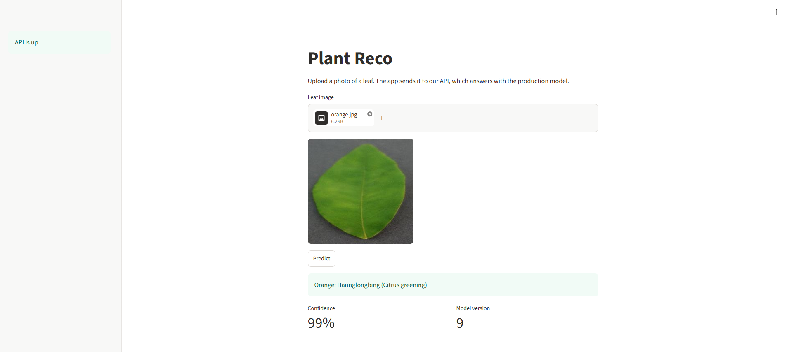
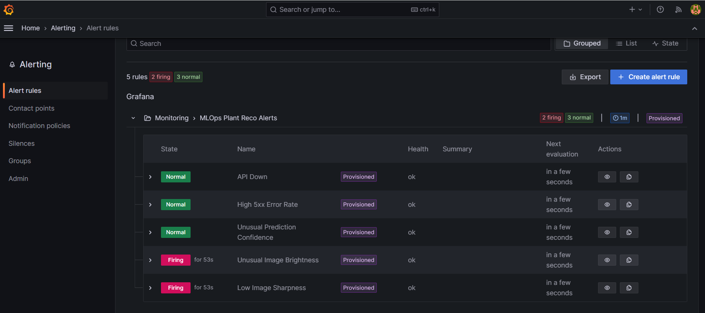
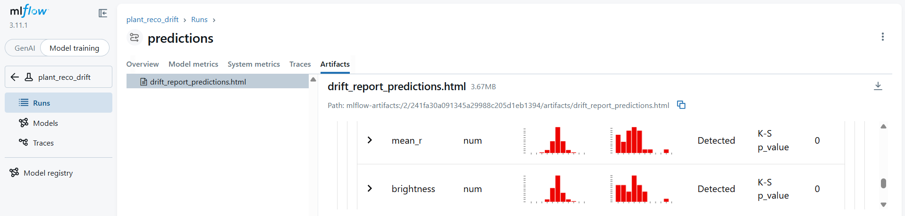
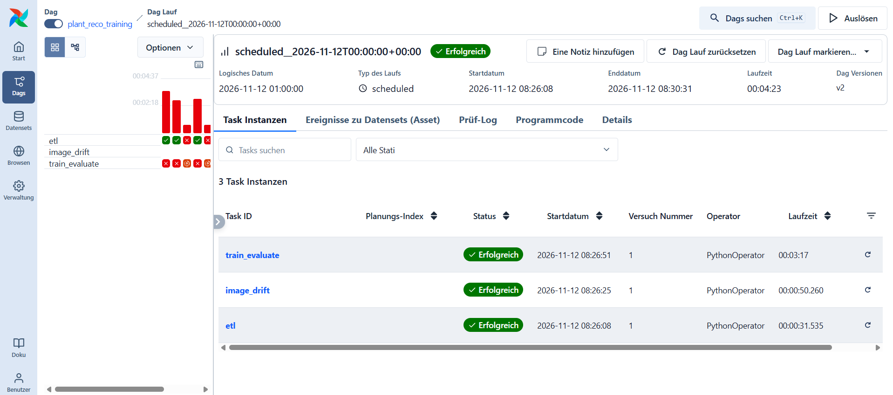
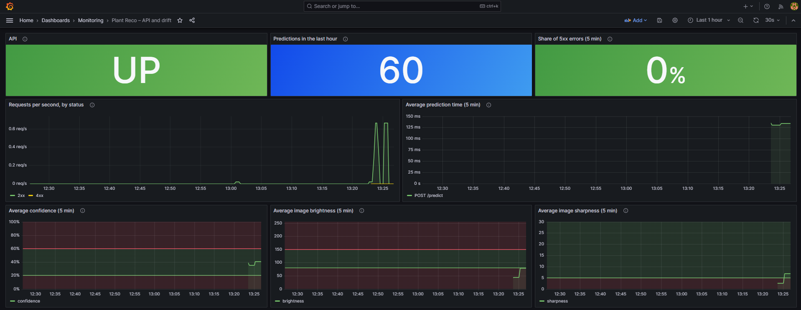
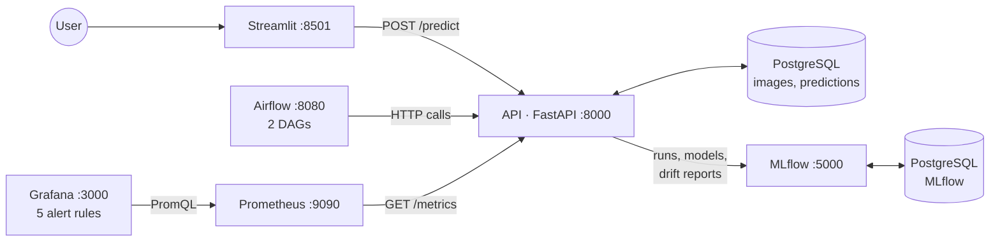
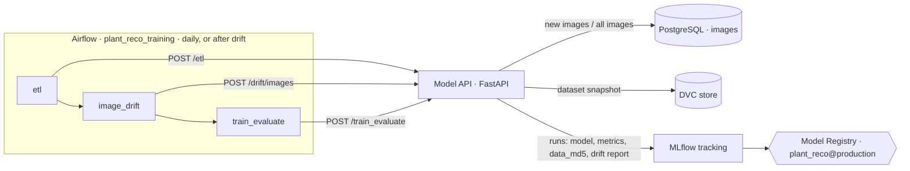
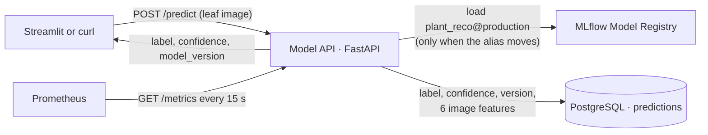
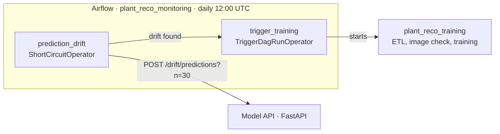

# Plant Reco — MLOps project

[](https://github.com/DataScientest-Studio/sep26_bmlops_int_plant_reco/actions/workflows/python-app.yml)

Recognise the plant species and its disease from a photo of a leaf, and build everything
around the model that makes it production-ready: data in a database, tracked and versioned
models, Docker microservices, scheduled retraining, and monitoring with alerts and data
drift detection.

Team: Karim KHALIFA, Christoph Clemens Martin NEDDENS, Adrian Bogdan RUS ·
Mentor: Nicolas FRADIN · Liora MLOps bootcamp (Sep 2026)

## Project objectives

Recognise the plant species and its disease from a photo of a leaf
(PlantVillage dataset, 54,305 colour images, 38 classes including 12 healthy ones).
The model is deliberately simple (a Random Forest on 32 × 32 pixels): the focus of the
project is the MLOps around it.

## Key metrics

**Model**
- Macro-F1 on a held-out test set (main metric, because the classes are unevenly sized:
  from about 150 to over 5,000 images). It also decides which model goes to production.
- Accuracy (secondary)

**Service**
- The API answers `/predict` correctly (status 200, a class name returned)
- Prediction time per image (latency)
- Monitored in production: API up or down, share of server errors, confidence of the
  predictions, brightness and sharpness of the incoming images, data drift

## Status

| Phase | Content | Status |
|---|---|---|
| 1 · Foundations | database, training and prediction scripts, FastAPI | done (12 Oct) |
| 2 · Microservices, tracking, versioning | PostgreSQL, Docker Compose, MLflow tracking and Model Registry, best-model promotion, ETL, Airflow, DVC | done (22 Oct) |
| 3 · Monitoring and maintenance | Prometheus metrics, Grafana dashboard and alerts, predictions stored with image features, drift simulation, Evidently drift checks in Airflow with reports in MLflow, retraining when drift is found, Streamlit app, CI with tests | done (12 Nov) |

## What it looks like

| | |
|---|---|
|  |  |
| **Streamlit**: upload a leaf photo, get the prediction from the API | **Grafana**: 30 dark test images fire the brightness and sharpness alerts |
|  |  |
| **MLflow**: the Evidently report of a drift check | **Airflow**: ETL, image drift check, training |


**Grafana dashboard**: 30 dark images, then 30 normal ones. Brightness and sharpness leave their
green bands and come back.

## Architecture

Nine services run with Docker Compose on one VM (Ubuntu, 2 CPUs, 3.8 GB memory):



| Service | Image | Port | What it does |
|---|---|---|---|
| `db` | postgres:17 | internal | the images (as bytes) with their labels (table `images`), and every prediction with its image features (table `predictions`) |
| `loader` | own `Dockerfile` | – | one-time job: creates the tables and loads 3,800 images (100 per class) |
| `api` | own `Dockerfile` (Python 3.12) | 8000 | FastAPI: ETL, training, prediction, drift checks, Prometheus metrics |
| `mlflow-db` | postgres:17 | internal | MLflow's runs, metrics and Model Registry |
| `mlflow` | `docker/mlflow/Dockerfile` (MLflow 3.11.1) | 5000 | tracking server, Model Registry, model files and drift reports |
| `airflow` | apache/airflow:3.1.8 (`standalone`) | 8080 | training pipeline (daily, 00:00 UTC) and monitoring pipeline (daily, 12:00 UTC; starts the training when drift is found) |
| `streamlit` | `streamlit_app/Dockerfile` | 8501 | web app for predictions; talks only to the API |
| `prometheus` | prom/prometheus:v2.45.0 | 9090 | collects the API's metrics every 15 seconds |
| `grafana` | grafana/grafana:10.0.0 | 3000 | a dashboard and five alert rules on those metrics, provisioned from files |

### Training pipeline (batch, scheduled by Airflow)



Airflow starts this pipeline every day at 00:00 UTC, and the monitoring pipeline starts it
when the latest predictions have drifted (see [Monitoring](#monitoring)).

1. **ETL** (`src/data/etl.py`): takes the next 20 not yet used images per class from the
   ~50,500 images on disk and adds them to PostgreSQL. This simulates new incoming data.
2. **Image drift check** (`src/monitoring/drift.py`): compares the new batch with the first
   load and logs the result in MLflow (see [Monitoring](#monitoring)). It does not stop
   the pipeline: the model is retrained every day, and the report shows whether the new
   data differ from the old.
3. **Versioning** (`src/data/versioning.py`): writes the list of all images in the
   database to `images.csv`, adds it to **DVC** (without Git, `dvc init --no-scm`)
   and returns its md5 hash.
4. **Training** (`src/models/training.py`): trains on all images, logs parameters,
   metrics, the model and the data hash `data_md5` as an **MLflow** run and registers
   a new version of the model `plant_reco`.
5. **Comparison** (`src/models/promote.py`): at the end of training, the new version's
   macro-F1 is compared with the version that has the alias `@production`. The alias
   moves only if the new model is better (the first model always gets it).

### Prediction pipeline (real time)



The API keeps the production model in memory and loads a new one only when the alias
`@production` moves, so a better model is used without rebuilding or restarting anything.
Every prediction is stored with six image features (brightness, contrast, mean red,
green and blue, sharpness) for the drift check, and counted in the Prometheus metrics.

## Monitoring

### Metrics and alerts (Prometheus, Grafana)

The API publishes its metrics on `GET /metrics`:
- HTTP requests by endpoint and status code, and their duration
  (`prometheus-fastapi-instrumentator`);
- `prediction_confidence`, `image_brightness` and `image_sharpness`: one value per
  prediction (histograms).

The Grafana dashboard **Plant Reco – API and drift** shows these metrics live: API up or
down, predictions in the last hour, share of 5xx errors, requests per second, average
prediction time, and the average confidence, brightness and sharpness with their alert
ranges drawn as green bands.

Grafana evaluates five rules every minute; a rule fires when its condition has held for
one minute. The dashboard, the rules and the Prometheus data source are files in
`docker/grafana/provisioning/`, so they exist on a fresh machine without any clicking.

| Alert | Fires when | Catches |
|---|---|---|
| API Down | Prometheus cannot reach the API (`up{job="api"}` < 1) | API stopped or crashed |
| High 5xx Error Rate | more than 5 % of the requests in the last 5 minutes end with a 5xx error | server errors, e.g. broken image files |
| Unusual Prediction Confidence | average confidence of the last 5 minutes outside 0.20–0.60 | a model that is unusually unsure (or sure) |
| Unusual Image Brightness | average brightness of the last 5 minutes outside 80–150 (scale 0–255) | too dark or too bright photos |
| Low Image Sharpness | average sharpness of the last 5 minutes below 5 | blurred photos |

The thresholds come from our own measurements: normal leaves have an average brightness
of about 115 and a sharpness of about 11 (see [Drift simulation](#drift-simulation)).

### Data drift (Evidently, run by Airflow, tracked in MLflow)

Two checks compare the six image features with the **first load** of 3,800 images
(100 per class, the historical data):

| Check | Current data | Runs in |
|---|---|---|
| `POST /drift/images` | the newest batch added by the ETL | DAG `plant_reco_training`, task `image_drift` (daily, 00:00 UTC) |
| `POST /drift/predictions?n=30` | the 30 latest predictions | DAG `plant_reco_monitoring`, task `prediction_drift` (daily, 12:00 UTC) |

When the prediction check finds drift, the monitoring pipeline starts the training pipeline:



`prediction_drift` returns True only if Evidently found drift; otherwise Airflow skips
`trigger_training`. The new model still reaches production only if its macro-F1 is better.

For each feature Evidently runs a Kolmogorov–Smirnov test. A feature has drifted if
p < 0.001, and the check reports drift if at least one feature has drifted. We chose this
after testing on real leaf features (300–400 random windows per case): Evidently's
default for a reference of more than 1,000 rows (Wasserstein distance, threshold 0.1)
raised an alarm for every window of 30 normal images, while the K-S test with p < 0.001
raised none and caught every window of 30 dark, bright or blurred images.

Each check is one MLflow run in the experiment `plant_reco_drift`: its settings as
parameters; `drift` (0 or 1), `drifted_features` and one p-value per feature as metrics;
and the Evidently HTML report as an artifact. (MLflow 3 opens in "GenAI" mode; switch
to "Model training" to see the runs.)

### Drift simulation

`src/data/simulate_drift.py` sends the same 30 images of the dataset to `/predict`,
unchanged or made dark, bright or blurred, and prints their averages:

```bash
docker compose exec -T api python -m src.data.simulate_drift dark   # normal, dark, bright or blur
curl -X POST "http://localhost:8000/drift/predictions?n=30"
```

Measured on the VM with model v9 (11 Nov 2026):

| 30 images | Confidence | Brightness | Sharpness | Grafana alerts | Evidently: drifted features |
|---|---|---|---|---|---|
| normal | 0.463 | 114.5 | 11.10 | none | none (no drift) |
| dark | 0.359 | 45.4 | 2.71 | brightness, sharpness | all 6 |
| bright | 0.264 | 176.6 | 15.26 | brightness | 5 (all but sharpness) |
| blur | 0.415 | 114.5 | 1.07 | sharpness | sharpness |

The confidence alone is a weak signal: it drops for dark and bright images but stays
inside its range, and it moves only a little for blurred ones. The image features and the
statistical test catch all three kinds of drift. A drift result is reported in Grafana and
MLflow, and drift in the predictions starts a retraining (v11 below was started this way).

## Results

Each Airflow run adds data, retrains and promotes the model only if macro-F1 improves:

| Model version | Images | Accuracy | Macro-F1 | `@production`? |
|---|---|---|---|---|
| v1 | 3,800 | 0.5368 | 0.5155 | yes (first model) |
| v2 | 3,800 | 0.5368 | 0.5155 | no (not better) |
| v3 | 4,560 | 0.5647 | 0.5487 | yes |
| v4 | 5,320 | 0.5733 | 0.5555 | yes |
| v5 | 6,072 | 0.5868 | 0.5734 | yes |
| v6 | 6,812 | 0.6119 | 0.5968 | yes |
| v7 | 7,552 | 0.6036 | 0.5905 | no (not better) |
| v8 | 8,292 | 0.6058 | 0.5896 | no (not better) |
| – | 9,032 to 12,667 | – | 0.606 to 0.633 | no version: the training was killed while saving the model (out of memory) |
| v9 | 14,071 | 0.6558 | 0.6313 | yes (11 Nov, after the memory fix) |
| v10 | 14,731 | 0.6512 | 0.6291 | no (not better, 12 Nov) |
| v11 | 15,391 | 0.6372 | 0.6150 | no (not better; started by the drift check, 12 Nov) |

Since v9, macro-F1 has fallen slightly although there are more images. A likely reason: the
ETL adds 20 images per class, but the smallest classes have run out of new images, so the
class mix becomes more unbalanced and the small classes weigh more in macro-F1. The
promotion rule keeps v9 in production.

**What went wrong between 26 Oct and 10 Nov, and the fix.** From about 9,000 images on,
every training logged its metrics and then died while saving the model: the Linux
out-of-memory killer stopped the API (visible in the kernel log, and as MLflow runs stuck
in "RUNNING"). There were two causes: MLflow starts a second Python process that loads the
whole model again to work out its pip requirements, and the training read all images from
PostgreSQL at once. We now pass `pip_requirements` to `log_model` and read the images in
batches with a server-side cursor. With 13,400 images the peak memory dropped from 2.2 GB
to 1.1 GB, with identical results.

## How to run

On a Linux machine with Docker and Docker Compose (we use the Liora Ubuntu VM):

```bash
# 1. Code
git clone https://github.com/DataScientest-Studio/sep26_bmlops_int_plant_reco.git
cd sep26_bmlops_int_plant_reco

# 2. Data (needs a Kaggle API token in KAGGLE_API_TOKEN)
python3 -m venv .venv
source .venv/bin/activate
pip install kaggle
kaggle datasets download -d abdallahalidev/plantvillage-dataset -p data/raw
unzip -q data/raw/plantvillage-dataset.zip "plantvillage dataset/color/*" -d data/raw
mv "data/raw/plantvillage dataset/color" data/raw/color

# 3. Settings and services
cp .env.example .env        # then set your own passwords in .env
docker compose up -d --build
docker compose ps
```

The web interfaces (replace `<VM-IP>` with the machine's public IP, or open an SSH
tunnel such as `ssh -L 3000:localhost:3000 …` and use `localhost`):

| Interface | Address |
|---|---|
| Streamlit app | `http://<VM-IP>:8501` |
| API documentation | `http://<VM-IP>:8000/docs` |
| MLflow (switch to "Model training") | `http://<VM-IP>:5000` |
| Airflow (user `admin`) | `http://<VM-IP>:8080` |
| Grafana (user `admin`, password `GRAFANA_ADMIN_PASSWORD` from `.env`) | `http://<VM-IP>:3000` |
| Prometheus | `http://<VM-IP>:9090` |

The Airflow password is generated at the first start:

```bash
docker compose exec airflow cat /opt/airflow/simple_auth_manager_passwords.json.generated
```

Run the pipelines by hand, without Airflow:

```bash
curl -X POST "http://localhost:8000/etl?per_class=20"
curl -X POST http://localhost:8000/drift/images
curl -X POST http://localhost:8000/train_evaluate
curl -X POST -F "file=@path/to/leaf.jpg" http://localhost:8000/predict
curl -X POST "http://localhost:8000/drift/predictions?n=30"
```

Or in Airflow: switch on the DAGs `plant_reco_training` and `plant_reco_monitoring`
(new DAGs start paused) or start them with **Trigger**.

Run the tests (they need no database and no MLflow server); GitHub Actions runs them,
with flake8, on every push to `master`:

```bash
pip install -r requirements.txt pytest
python -m pytest
```

### API endpoints

| Endpoint | What it does |
|---|---|
| `GET /` | health check: `{"status": "ok"}` |
| `POST /etl?per_class=20` | adds the next batch of new images to the database |
| `POST /train_evaluate` | versions the data, trains, logs to MLflow, registers and compares the model (`/training` is kept as an alias) |
| `POST /predict` | upload a leaf image (`file`, `.jpg` or `.png`), get label, confidence and the model version; the prediction is stored with its image features |
| `POST /drift/images` | compares the newest batch of images with the first load (Evidently), logs the result in MLflow |
| `POST /drift/predictions?n=30` | compares the 30 latest predictions with the first load |
| `GET /metrics` | metrics for Prometheus |

## Design decisions

| Decision | Why |
|---|---|
| PostgreSQL server instead of the SQLite file | several containers read and write the data at the same time |
| The model lives in the MLflow Model Registry | changing the production model means moving an alias, not rebuilding the API |
| MLflow serves the model files itself (`--artifacts-destination`) | no folder has to be shared between containers |
| One pinned version of MLflow (3.11.1) and scikit-learn (1.9.1) | a model must be loaded with the library versions that saved it |
| Named volumes for both databases, the model files, DVC, Airflow, Prometheus and Grafana | data, runs, models and alert history survive `docker compose down` |
| Settings in `.env` (only `.env.example` is in Git) | passwords stay out of Git |
| Airflow only calls the API | the training, ETL and drift code lives in one place; Airflow decides when it runs |
| Airflow `standalone` with `PARALLELISM=4`, `max_active_runs=1` | the VM has 3.8 GB of memory; never two trainings at once |
| MLflow server: `--workers 1`, `MLFLOW_SERVER_ENABLE_JOB_EXECUTION=false` | cuts its memory from about 1.4 GB to about 0.35 GB |
| MLflow server: PostgreSQL driver `psycopg2` | with psycopg 3 and SQLAlchemy 2.1, MLflow's registry queries fail on PostgreSQL |
| MLflow server: `--allowed-hosts "*"`, `--cors-allowed-origins "*"` | MLflow ≥ 3.5 otherwise rejects requests from other containers and from the browser on the VM's public IP (course VM only) |
| The API keeps the production model in memory | it used to download the model for every request (3 GB in `/tmp` after 27 predictions) |
| Training: `pip_requirements` in `log_model`, images read in batches | halves the memory of a training (see [Results](#results)) |
| Streamlit talks only to the API | one place for the model logic; the app needs no database access |
| Grafana rules and data source as provisioned files | the alerts are versioned in Git and exist on a fresh machine |
| Prometheus metrics for image brightness and sharpness, not only the confidence | our measurements showed that the confidence hardly reacts to dark or blurred images |
| Six simple image features as the drift input | cheap to compute for every prediction, stored with it, easy to explain |
| Reference for drift = the first load of 3,800 images | a fixed, balanced historical sample (100 per class) |
| K-S test with p < 0.001; one drifted feature is enough | Evidently's default raised false alarms for every window of 30 normal predictions |
| Drift in the predictions starts the training DAG (`ShortCircuitOperator`, `TriggerDagRunOperator`) | an automatic reaction to drift that stays inside Airflow and needs no extra credentials; the promotion rule still decides |
| Grafana dashboard as a provisioned file | the same live view on every machine, versioned in Git |
| CI with GitHub Actions: Python 3.12, flake8, pytest | every push is checked; the tests run without a database or MLflow |

## Project structure

```
├── docker-compose.yml               all nine services
├── Dockerfile                       image of api and loader
├── .env.example                     setting names with dummy values
├── .github/workflows/python-app.yml CI: flake8 and pytest on every push
├── docker/
│   ├── mlflow/Dockerfile            image of the MLflow server
│   ├── prometheus/prometheus.yml    what Prometheus collects
│   └── grafana/provisioning/        Grafana data source, dashboard and alert rules
├── streamlit_app/                   Streamlit app and its Dockerfile
├── airflow/dags/
│   ├── training_pipeline.py         DAG: etl → image_drift → train_evaluate, daily
│   └── monitoring_pipeline.py       DAG: prediction_drift → trigger_training, daily
├── src/
│   ├── api/main.py                  FastAPI endpoints and Prometheus metrics
│   ├── data/db.py                   PostgreSQL connection (DATABASE_URL)
│   ├── data/make_dataset.py         tables and first load: 100 images per class
│   ├── data/etl.py                  next batch of new images
│   ├── data/versioning.py           DVC snapshot of the dataset, md5 hash
│   ├── data/predictions.py          stores each prediction with its features
│   ├── data/simulate_drift.py       sends normal, dark, bright or blurred images
│   ├── features/build_features.py   the six image features
│   ├── models/training.py           training with MLflow tracking
│   ├── models/promote.py            comparison and @production alias
│   ├── models/predict.py            prediction with the production model
│   └── monitoring/drift.py          Evidently drift checks, logged in MLflow
├── reports/figures/                 screenshots for this README
├── tests/test_api.py                tests: API, preprocessing, image features
└── requirements.txt                 pinned Python libraries
```

Not in Git: `data/` (images), `.env`, model files.

## Team

- **Karim KHALIFA**
- **Christoph Clemens Martin NEDDENS**
- **Adrian Bogdan RUS**

Mentor: **Nicolas FRADIN**
