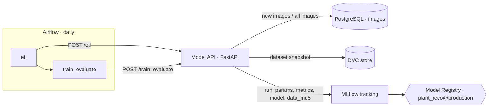
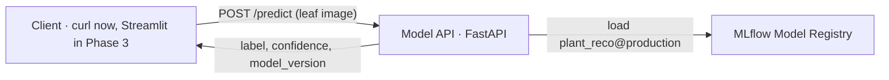

# Plant Reco — MLOps project

Recognise the plant species and its disease from a photo of a leaf, and build everything
around the model that makes it production-ready: data in a database, tracked and versioned
models, Docker microservices and scheduled retraining.

Team: Christoph, Adrian, Karim · Mentor: Nicolas · Liora MLOps bootcamp (Sep 2026)

## Project objectives

Recognise the plant species and its disease from a photo of a leaf
(PlantVillage dataset, 54,305 colour images, 38 classes including 12 healthy ones).
The model is deliberately simple (a Random Forest on 32 × 32 pixels): the focus of the
project is the MLOps around it.

## Key metrics

**Model**
- Macro-F1 on a held-out test set (main metric, because the classes are unevenly sized:
  from about 150 to over 5,000 images). It also decides which model goes to production.
- Accuracy (secondary)

**Service**
- The API answers `/predict` correctly (status 200, a class name returned)
- Prediction time per image (latency)

## Status

| Phase | Content | Status |
|---|---|---|
| 1 · Foundations | database, training and prediction scripts, FastAPI | done (12 Oct) |
| 2 · Microservices, tracking, versioning | PostgreSQL, Docker Compose, MLflow tracking and Model Registry, best-model promotion, ETL, Airflow, DVC | done (22 Oct) |
| 3 · Monitoring and maintenance | drift detection (Evidently), Prometheus/Grafana, Streamlit app | next |

## Architecture

Six services run with Docker Compose on one VM:

| Service | Image | Port | What it does |
|---|---|---|---|
| `db` | postgres:17 | internal | the images (as bytes) and their labels, table `images` |
| `loader` | own `Dockerfile` | – | one-time job: loads 3,800 images (100 per class) into `db` |
| `api` | own `Dockerfile` (Python 3.12) | 8000 | FastAPI: `/etl`, `/train_evaluate`, `/predict` |
| `mlflow-db` | postgres:17 | internal | MLflow's runs, metrics and Model Registry |
| `mlflow` | `docker/mlflow/Dockerfile` (MLflow 3.11.1) | 5000 | tracking server, Model Registry, model files |
| `airflow` | apache/airflow:3.1.8 (`standalone`) | 8080 | runs the training pipeline every day |

### Training pipeline (batch, scheduled by Airflow)



1. **ETL** (`src/data/etl.py`): takes the next 20 not yet used images per class from the
   ~50,500 images on disk and adds them to PostgreSQL. This simulates new incoming data.
2. **Versioning** (`src/data/versioning.py`): writes the list of all images in the
   database to `images.csv`, adds it to **DVC** (without Git, `dvc init --no-scm`)
   and returns its md5 hash.
3. **Training** (`src/models/training.py`): trains on all images, logs parameters,
   metrics, the model and the data hash `data_md5` as an **MLflow** run and registers
   a new version of the model `plant_reco`.
4. **Comparison** (`src/models/promote.py`): at the end of training, the new version's
   macro-F1 is compared with the version that has the alias `@production`. The alias
   moves only if the new model is better (the first model always gets it).

### Prediction pipeline (real time)



The API keeps no model file of its own: it always loads the version that currently
carries `@production`, so a better model is used without rebuilding or restarting anything.

## Results so far

Each Airflow run adds data, retrains and promotes the model only if macro-F1 improves:

| Model version | Images | Accuracy | Macro-F1 | `@production`? |
|---|---|---|---|---|
| v1 | 3,800 | 0.5368 | 0.5155 | yes (first model) |
| v2 | 3,800 | 0.5368 | 0.5155 | no (not better) |
| v3 | 4,560 | 0.5647 | 0.5487 | yes |
| v4 | 5,320 | 0.5733 | 0.5555 | yes (scheduled Airflow run) |
| v5 | 6,072 | 0.5868 | 0.5734 | yes (Airflow run) |

## How to run

On a Linux machine with Docker and Docker Compose (we use the Liora Ubuntu VM):

```bash
# 1. Code
git clone https://github.com/DataScientest-Studio/sep26_bmlops_int_plant_reco.git
cd sep26_bmlops_int_plant_reco

# 2. Data (needs a Kaggle API token in KAGGLE_API_TOKEN)
python3 -m venv .venv
source .venv/bin/activate
pip install kaggle
kaggle datasets download -d abdallahalidev/plantvillage-dataset -p data/raw
unzip -q data/raw/plantvillage-dataset.zip "plantvillage dataset/color/*" -d data/raw
mv "data/raw/plantvillage dataset/color" data/raw/color

# 3. Settings and services
cp .env.example .env
docker compose up -d --build
docker compose ps
```

The web interfaces (replace `<VM-IP>` with the machine's public IP):

| Interface | Address |
|---|---|
| API documentation | `http://<VM-IP>:8000/docs` |
| MLflow (switch to "Model training") | `http://<VM-IP>:5000` |
| Airflow (user `admin`) | `http://<VM-IP>:8080` |

The Airflow password is generated at the first start:

```bash
docker compose exec airflow cat /opt/airflow/simple_auth_manager_passwords.json.generated
```

Run the pipeline by hand, without Airflow:

```bash
curl -X POST "http://localhost:8000/etl?per_class=20"
curl -X POST http://localhost:8000/train_evaluate
curl -X POST -F "file=@path/to/leaf.jpg" http://localhost:8000/predict
```

Or in Airflow: switch on the DAG `plant_reco_training` (it then runs daily at 00:00 UTC)
or start it with **Trigger**.

### API endpoints

| Endpoint | What it does |
|---|---|
| `GET /` | health check: `{"status": "ok"}` |
| `POST /etl?per_class=20` | adds the next batch of new images to the database |
| `POST /train_evaluate` | versions the data, trains, logs to MLflow, registers and compares the model (`/training` is kept as an alias) |
| `POST /predict` | upload a leaf image (`file`), get label, confidence and the model version |

## Design decisions

| Decision | Why |
|---|---|
| PostgreSQL server instead of the SQLite file | several containers read and write the data at the same time |
| The model lives in the MLflow Model Registry | changing the production model means moving an alias, not rebuilding the API |
| MLflow serves the model files itself (`--artifacts-destination`) | no folder has to be shared between containers |
| One pinned version of MLflow (3.11.1) and scikit-learn (1.9.1) | a model must be loaded with the library versions that saved it |
| Named volumes for both databases, the model files, DVC and Airflow | data, runs and models survive `docker compose down` |
| Settings in `.env` (only `.env.example` is in Git) | passwords stay out of Git |
| Airflow only calls the API | the training code lives in one place; Airflow decides when it runs |
| Airflow `standalone` with `PARALLELISM=4`, `max_active_runs=1` | the VM has 3.8 GB of memory; never two trainings at once |
| MLflow server: `--workers 1`, `MLFLOW_SERVER_ENABLE_JOB_EXECUTION=false` | cuts its memory from about 1.4 GB to about 0.35 GB |
| MLflow server: PostgreSQL driver `psycopg2` | with psycopg 3 and SQLAlchemy 2.1, MLflow's registry queries fail on PostgreSQL |
| MLflow server: `--allowed-hosts "*"`, `--cors-allowed-origins "*"` | MLflow ≥ 3.5 otherwise rejects requests from other containers and from the browser on the VM's public IP (course VM only) |

## Project structure

```
├── docker-compose.yml          all six services
├── Dockerfile                  image of api and loader
├── docker/mlflow/Dockerfile    image of the MLflow server
├── .env.example                setting names with dummy values
├── airflow/dags/
│   └── training_pipeline.py    DAG: etl → train_evaluate, daily
├── src/
│   ├── api/main.py             FastAPI endpoints
│   ├── data/db.py              PostgreSQL connection (DATABASE_URL)
│   ├── data/make_dataset.py    first load: 100 images per class
│   ├── data/etl.py             next batch of new images
│   ├── data/versioning.py      DVC snapshot of the dataset, md5 hash
│   ├── models/training.py      training with MLflow tracking
│   ├── models/promote.py       comparison and @production alias
│   └── models/predict.py       prediction with the production model
└── requirements.txt            pinned Python libraries
```

Not in Git: `data/` (images), `.env`, model files.

## Team

- **Adrian**: PostgreSQL migration and the first Docker setup (`db`, `loader`, `api`)
- **Christoph**: MLflow server, tracking, registry and comparison, ETL, DVC, Airflow, integration
- **Karim**: phase 3
